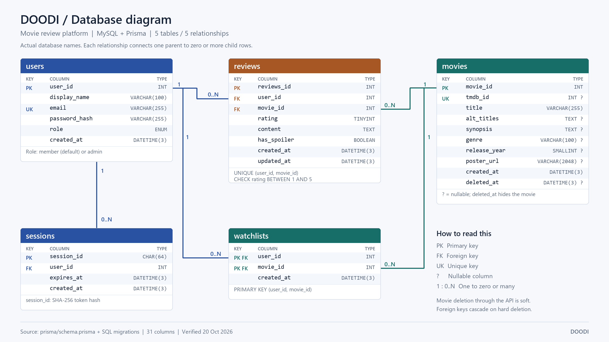

# DOODI Movie Review: API, Pages and Database

Verified 2026-10-20 against the route handlers, validation schemas, service functions, Prisma schema and SQL migrations. This describes the implementation; the live database and deployed API were not queried.

**Presentation overview:** 21 explicitly implemented API operations across 15 URL paths: 19 under `/api/v1` and 2 maintenance operations under `/api/cron`. The database has 5 application tables and 5 foreign-key relationships.

**Diagram downloads:** [PNG for slides](database-diagram.png) · [SVG for scaling](database-diagram.svg) · [Editable Mermaid source](database-diagram.mmd). The diagram uses actual database table and column names.

Stack: Next.js (App Router), Prisma 7 + MySQL (MariaDB adapter), argon2 password hashing, zod validation, deployed on Vercel (project `serversideproject`).

---

## 1. Pages

| Path | Access | Notes |
|---|---|---|
| `/` | Public | Home. Shows top-rated movies that have reviews (`featuredMovies`). |
| `/movies` | Public | Movie list. Query: `q`, `genre`, `year`, `sort` (`newest` / `top_rated` / `most_reviewed`), `page`. |
| `/movies/[id]` | Public | Detail page. Full-screen hero with TMDB backdrop and idle trailer, synopsis, reviews, review form. `id` must be a positive int. |
| `/login` | Public | Redirects to `?next=` if already signed in. |
| `/register` | Public | Redirects to `?next=` if already signed in. |
| `/watchlist` | Signed in | Redirects to `/login?next=/watchlist` if not signed in. |
| `/admin` | Admin | Movie management. Non-admins are redirected to `/`. |
| `/admin/tmdb` | Admin | Search TMDB and import movies. |
| `/admin/reviews` | Admin | Review moderation list. |
| `/icon`, `/apple-icon`, `/opengraph-image` | Public | Generated images. |

All pages are `force-dynamic` (rendered per request). `not-found` and `error` boundaries exist.

---

## 2. API

Base path: `/api/v1`. Authentication is a session cookie, `doodi_session` (HttpOnly, SameSite=Lax, 30 days).

Paths in the application endpoint tables below are relative to `/api/v1`; cron paths are shown in full. `{id}` means a movie ID in `/movies/{id}` and a review ID in `/reviews/{id}`. `{movieId}` is a movie ID. IDs are positive integers, at most 2147483647. "Signed in" includes both members and admins; "Owner or admin" means the review's author or an admin.

The count includes the HTTP methods explicitly exported in the source. Framework-generated `HEAD`/`OPTIONS` handling is excluded. There are no explicitly implemented `PUT`, `HEAD` or `OPTIONS` handlers. Server-side helpers and generated page images are not additional application API endpoints.

### Response format

- Success: `{ "data": ... }` (status 200 or 201)
- Paged application list: `{ "data": [...], "meta": { "page": 1, "page_size": 12, "total": 30, "total_pages": 3 } }` (TMDB search omits `page_size`)
- No content: `204`
- Error: `{ "error": { "code", "message", "fields"? } }`

Common error codes: `validation_error` (400), `unauthenticated` (401), `forbidden` (403), `csrf_rejected` (403), `*_not_found` (404), `conflict` / `email_taken` / `review_exists` / `already_in_watchlist` / `tmdb_already_imported` (409), `rate_limited` (429), `internal_error` (500).

Malformed JSON returns 400 `invalid_json`; invalid path IDs return 400 `invalid_id`. TMDB can return 503 `tmdb_not_configured`, 502 for upstream failures or invalid upstream credentials, 404 for an unknown TMDB movie, and 429 for upstream rate limiting. These are in addition to the access and validation errors above.

### Endpoints

#### Auth

| Method | Path | Access | Body / Query | Result |
|---|---|---|---|---|
| POST | `/auth/register` | Public | `display_name` (2-100), `email`, `password` (8-128), `password_confirmation` | 201 user + sets cookie. Always creates role `member`. |
| POST | `/auth/login` | Public | `email`, `password` | 200 user + sets cookie. 401 `invalid_credentials`. |
| POST | `/auth/logout` | Anyone | none | 204, clears cookie. |
| GET | `/auth/me` | Signed in | none | 200 current user. |

#### Movies

| Method | Path | Access | Body / Query | Result |
|---|---|---|---|---|
| GET | `/movies` | Public | `q` (max 100, searches title and alt titles), `genre` (single, max 50), `year` (1800-2200), `sort` (`newest`, `top_rated`, `most_reviewed`; default `newest`), `page`, `page_size` (default 12, max 50) | 200 paged movies with `average_rating` and `review_count`. |
| POST | `/movies` | Admin | `title` (1-255), `synopsis?` (max 10000), `genre?` (comma-separated, 100 chars total), `release_year?` (1888 to current year + 5), `poster_url?` (http(s), max 2048) | 201 movie. |
| GET | `/movies/{id}` | Public | none | 200 movie, or 404 if missing or soft-deleted. |
| PATCH | `/movies/{id}` | Admin | Same fields as POST, all optional, at least one required | 200 movie. |
| DELETE | `/movies/{id}` | Admin | none | 204. Soft delete (sets `deleted_at`). |

#### Reviews

| Method | Path | Access | Body / Query | Result |
|---|---|---|---|---|
| GET | `/movies/{id}/reviews` | Public | `page`, `page_size` (default 10, max 50) | 200 paged reviews. |
| POST | `/movies/{id}/reviews` | Signed in | `rating` (int 1-5), `content` (5-5000), `has_spoiler?` (bool, default false) | 201 review. 409 if you already reviewed this movie. |
| PATCH | `/reviews/{id}` | Owner or admin | `rating?`, `content?`, `has_spoiler?` (at least one) | 200 review. |
| DELETE | `/reviews/{id}` | Owner or admin | none | 204. |

#### Watchlist

| Method | Path | Access | Body / Query | Result |
|---|---|---|---|---|
| GET | `/watchlist/me` | Signed in | `page`, `page_size` (default 12, max 50) | 200 paged saved movies, each with `added_at`. |
| POST | `/watchlist/me` | Signed in | `movie_id` | 201. 409 if already saved, 404 if the movie doesn't exist. |
| DELETE | `/watchlist/me/{movieId}` | Signed in | none | 204. 404 if not in the list. |

#### Admin and TMDB

| Method | Path | Access | Body / Query | Result |
|---|---|---|---|---|
| GET | `/admin/reviews` | Admin | `q` (movie-title search, max 100), `page`, `page_size` (default 10, max 50) | 200 paged reviews across visible movies, each with `movie_title`. |
| GET | `/admin/tmdb/search` | Admin | `query` (1-100), `page` | 200 paged TMDB results, each with `already_imported`. |
| POST | `/admin/tmdb/import` | Admin | `tmdb_id` | 201 movie. Pulls Thai title, synopsis, genres, year, poster and alt titles. 409 if already imported, including previously deleted ones. |

#### Cron (not for browsers)

| Method | Path | Auth | Purpose |
|---|---|---|---|
| GET | `/api/cron/import-current` | `Authorization: Bearer $CRON_SECRET` | Imports up to 20 new movies from TMDB now-playing and popular (region TH). Scheduled daily at 09:17 Asia/Bangkok (02:17 UTC) in `vercel.json`. Returns 200 with `{ "data": { "candidates": 0, "imported": [], "failed": [] } }`; arrays contain TMDB IDs. |
| GET | `/api/cron/backfill-titles` | `Authorization: Bearer $CRON_SECRET` | One-off. Attempts to fill `alt_titles` for up to 25 older movies per call. Manual only. Returns 200 with `{ "data": { "scanned": 0, "updated": 0 } }`. |

Both return 503 `cron_not_configured` if `CRON_SECRET` is unset, or 401 `unauthorized` for an incorrect/missing bearer token. These GET requests can modify the database.

### Cross-cutting rules

- **CSRF:** write requests (anything other than GET/HEAD/OPTIONS) need an `Origin` header matching the host. A request with no `Origin` is accepted only if it carries no cookie.
- **Rate limits** (in-memory, per server instance, so approximate on serverless):
  - login: 30 per 15 min per IP, and 8 per 15 min per email
  - register: 10 per hour per IP
- **Login timing:** a dummy argon2 hash is verified when the email is unknown, so response time doesn't reveal which emails exist.
- **Pagination:** `page` 1-100000, `page_size` max 50.
- **Not an API route:** the trailer and backdrop on the movie page come from TMDB on the server (`heroMediaOf`). They are cached for 24 hours and add no endpoint.

---

## 3. Database (MySQL)

Five tables, plus Prisma's `_prisma_migrations`.



`PK` = primary key, `FK` = foreign key, `UK` = unique key. Each relationship is one parent to zero or more child rows; each child references exactly one parent. The standalone Mermaid file contains the full editable diagram.

### `users`

| Column | Type | Notes |
|---|---|---|
| `user_id` | INT, PK, auto-increment | |
| `display_name` | VARCHAR(100) | |
| `email` | VARCHAR(255), **unique** | Stored lowercase. |
| `password_hash` | VARCHAR(255) | argon2 |
| `role` | ENUM(`member`, `admin`), default `member` | |
| `created_at` | DATETIME(3), default now | |

### `movies`

| Column | Type | Notes |
|---|---|---|
| `movie_id` | INT, PK, auto-increment | |
| `tmdb_id` | INT, null, **unique** | Null for movies added by hand. |
| `title` | VARCHAR(255) | Index |
| `alt_titles` | TEXT, null | Newline-separated titles in other languages, used by search. |
| `synopsis` | TEXT, null | |
| `genre` | VARCHAR(100), null | Comma-separated, e.g. `Action,Drama`. |
| `release_year` | SMALLINT, null | Index |
| `poster_url` | VARCHAR(2048), null | |
| `created_at` | DATETIME(3), default now | Index with `deleted_at` |
| `deleted_at` | DATETIME(3), null | Soft delete marker. |

### `reviews`

| Column | Type | Notes |
|---|---|---|
| `reviews_id` | INT, PK, auto-increment | |
| `user_id` | INT, FK to `users` | ON DELETE CASCADE |
| `movie_id` | INT, FK to `movies` | ON DELETE CASCADE |
| `rating` | TINYINT | CHECK between 1 and 5 (`reviews_rating_range`) |
| `content` | TEXT | |
| `has_spoiler` | BOOLEAN, default false | |
| `created_at` | DATETIME(3), default now | |
| `updated_at` | DATETIME(3), auto-updated | |

Unique `(user_id, movie_id)`: one review per user per movie. Index `(movie_id, created_at)`.

### `watchlists`

| Column | Type | Notes |
|---|---|---|
| `user_id` | INT, FK to `users` | ON DELETE CASCADE |
| `movie_id` | INT, FK to `movies` | ON DELETE CASCADE. Index. |
| `created_at` | DATETIME(3), default now | |

Composite primary key `(user_id, movie_id)`.

### `sessions`

| Column | Type | Notes |
|---|---|---|
| `session_id` | CHAR(64), PK | SHA-256 hash of the cookie token, so a leaked table can't be replayed. |
| `user_id` | INT, FK to `users` | ON DELETE CASCADE. Index. |
| `expires_at` | DATETIME(3) | Index. Sessions last 30 days. |
| `created_at` | DATETIME(3), default now | |

### Relationships

```
users 1 --- * reviews   * --- 1 movies
users 1 --- * watchlists * --- 1 movies
users 1 --- * sessions
```

Hard-deleting a user cascades to that user's reviews, watchlist entries and sessions. Hard-deleting a movie cascades to its reviews and watchlist entries. Movies deleted through the API are only soft-deleted, so their rows, reviews and watchlist entries stay; public movie and review lists and the visible watchlist exclude them.

### Presentation talking points

- A user can write many reviews and save many movies. A movie can have many reviews and appear in many users' watchlists.
- `reviews` and `watchlists` connect users and movies. A unique `(user_id, movie_id)` pair allows only one review and one watchlist entry per user per movie.
- `sessions` stores login sessions. Passwords are hashed with Argon2, and session IDs store SHA-256 token hashes.
- `average_rating` and `review_count` are calculated from reviews; they are API fields, not stored movie columns.
- Genres are stored as a comma-separated string on `movies`; there is no separate genre table. TMDB is an external service, not an application database table.
- Optional movie columns are `tmdb_id`, `alt_titles`, `synopsis`, `genre`, `release_year`, `poster_url` and `deleted_at`. All other columns are required.

### Migrations

1. `20261002073823_init`: all five tables, foreign keys, indexes.
2. `20261002080000_rating_check`: CHECK constraint on `reviews.rating`.
3. `20261014000000_movie_alt_titles`: adds `movies.alt_titles`.

### Environment variables

`DATABASE_URL`, `DATABASE_CA` (provider CA for TLS), `DB_POOL_SIZE` (default 3 on Vercel, 10 elsewhere), `TMDB_API_READ_ACCESS_TOKEN`, `CRON_SECRET`, `APP_ORIGIN`.
